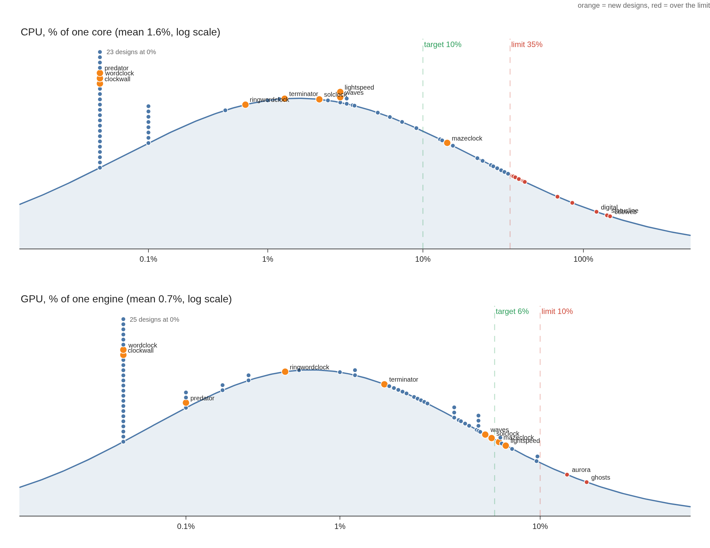

# Lock screen standards

A lock screen runs on every monitor, for as long as the machine sits locked.
It should cost almost nothing. These are the limits a design has to meet, how
they were chosen, and how to build a design that stays under them.

`tests/standards.test.cjs` checks them. Run it with `node --test tests/*.test.cjs`.

## Budgets

Measured with `tests/bench-lock-load.sh` at 1920x1080: CPU as a percent of one
core (100 = a core fully busy), GPU as a percent of one GPU engine. One design
runs alone in a window, after a 3 s warm-up, sampled for 8 s.

| | CPU | GPU | Memory (RSS) |
|---|---|---|---|
| **Target** (aim here) | 10% or less | 6% or less | n/a |
| **Limit** (must not exceed) | 35% | 10% | 320 MB |

A new design must be under the limit before it is enabled in `Designs.js`, and
should be under the target. Designs with no animation should measure near zero.

Memory is about 225 MB for every design (the shell itself), so it only guards
against a leak or a huge image or video.

### Where the limits come from

78 designs measured on 2026-10-19 (full results in
`tests/bench-results/full-1080p.csv`):

```
CPU % of one core                      GPU % of one engine
   0-1   25 █████████████████████████     0-1   27 ███████████████████████████
   1-5    8 ████████                      1-2    6 ██████
  5-10    4 ████                          2-4    7 ███████
 10-20    3 ███                           4-6   11 ███████████
 20-35    6 ██████                        6-8    3 ███
 35-60    9 █████████                     8-10   4 ████
60-100    2 ██                           10-12   2 ██
  100+    4 ████                           12+   1 █
```

On a log scale it is close to one. Each dot is a design, sitting on the fitted
curve at its measured value (orange are the newest designs, red are over the
limit). Regenerate with `python3 tests/bench-curves.py`.



On a plain scale it is not a bell curve. CPU splits into two groups: designs that draw nothing
per frame (median 4.3%) and designs that repaint something every frame (30%
and up, four of them over a whole core). Mean 22% and standard deviation 36%
are not much use for that shape, so the limits come from where the groups
separate instead:

- **Target**: 10% CPU and 6% GPU. About 60% of designs already meet it, and
  everything that sits there is built from retained scene-graph items.
- **Limit**: 35% CPU is one standard deviation above the geometric mean on a
  log scale, and 10% GPU is the same for GPU. About 75% of designs are under it.

GPU is mostly a per-pixel cost of keeping the window redrawing (a design with
any running animation lands around 3 to 9%), so the GPU limit only catches
designs that add full-screen blending or blur on top.

## Rules for building a design

These are what separates the cheap designs from the expensive ones in the
measurements. Of the designs over 90% CPU, `proton`, `tracker` and `bullet`
repaint a Canvas from a timer, and `statusline` and `digital` stream frames
from the `ttfx` effect through `TtfxText`.

1. **Do not repaint a full-screen `Canvas` every frame.** A Canvas redraws all
   of its pixels and uploads them each time, and `fillText` with `shadowBlur`
   is the most expensive call of all. Terminator went from 100% to 6% CPU by
   moving off it. A Canvas is fine for something drawn once or on an event
   (scan lines, a ring that fills per key).
2. **Prefer retained scene-graph items that an animation moves.** `Rectangle`,
   `Text`, `Image`, and `NumberAnimation` on `x`, `y`, `opacity`, `rotation`
   or `scale` are drawn by the GPU with almost no CPU. Slide a row of `Text`
   instead of redrawing it.
3. **Gate every animation and timer on `animating`.** `DesignBase` exposes
   `animating` (true only while the screen is awake and visible). Use it for
   `running:` on every `Timer`, `Animation` and `FrameAnimation`, so a locked
   screen with the display off does no work.
4. **Update slowly changing values on a slow timer.** A readout that changes
   six times a second needs a 150 ms `Timer`, not a per-frame binding. Run a
   timer only while it has something to do (for example, only while a line is
   typing out).
5. **Do per-pixel effects in a shader, at half size.** Many moving things (a
   star field, rain, particles) are too many items for QML to update every
   frame and too slow for a Canvas. A `ShaderEffect` draws them on the GPU from
   a couple of numbers. Lightspeed went from 48% to under 4% CPU this way. Write
   the shader in `designs/shaders/<name>.frag`, compile it with
   `qsb --qt6 -o <name>.frag.qsb <name>.frag` (from `qt6-shadertools`) and
   commit both files. Render the effect into a half size layer
   (`layer.enabled`, `layer.textureSize`) so it shades a quarter of the pixels.
   Keep the per-pixel work small: a design that did three star lookups per
   pixel used 23% GPU, two lookups at half size used 7%.
6. **No `shadowBlur` or `MultiEffect` blur over the whole screen** on an
   animated design, and keep any full-screen shader cheap (rule 5). Fake a glow
   with one low-alpha duplicate.
7. **Keep the item count down.** A few dozen `Text` rows is fine. Hundreds of
   animated items, or a particle system with a `Repeater` of every particle, is
   not. Cap counts by the screen size.
8. **Use `Repeater` model sizes that cannot go negative.** Before the window has
   a size, `height` is 0. Clamp with `Math.max(0, ...)`.
9. **Treat `TtfxText` as expensive.** It reads a frame stream from an external
   `ttfx` process and re-parses it into text, which cost over a whole core in
   `statusline` and `digital`. Use it for a short effect that ends, not as a
   permanent animation, and stop it when `animating` is false.
10. **Keep images and videos small.** Memory should stay under the limit above.

## Measuring a design

```
tests/bench-lock-load.sh terminator             # one design
tests/bench-lock-load.sh                         # every enabled design
BENCH_SIZE=2560x1440 BENCH_SECONDS=15 tests/bench-lock-load.sh card
```

To just look at a design, `tests/run-in-window.sh <id>` opens it in one window
(`tests/run-in-window.sh list` prints the ids).

The script opens a window on your live screen for each design, so leave the
machine alone while it runs. It prints a table and writes a CSV (default in
`~/.cache/omarchy-lock-explorer/`). To record a result for the test, run
the full set with `BENCH_OUT=tests/bench-results/full-1080p.csv`.

A disabled design (commented out in `Designs.js`) is not benchmarked; enable it
locally first.

The benchmark runs without a wallpaper by default. A design that tints, blurs
or otherwise processes the wallpaper costs more with one, so measure it with
`BENCH_WALLPAPER=~/Pictures/some.jpg tests/bench-lock-load.sh <id>`. `terminator`
is recorded that way. A wallpaper adds memory (about 60 to 75 MB on a large image), so
it can come close to the memory limit.

## What the test checks

`tests/standards.test.cjs`:

- **Budgets.** Every enabled design in `tests/bench-results/full-1080p.csv` is
  under the limit. A design missing from the CSV fails, so add new designs to
  it. Designs listed in `LEGACY` in the test are over the limit today and are
  allowed to stay there, but may not get worse and must not be added to.
- **Static rules.** A design that repaints a Canvas from a `Timer` or
  `FrameAnimation` must reference `animating` (rule 3), and must not use
  `shadowBlur` (rule 1).

The test cannot run the benchmark itself, since that needs a Wayland session,
so refresh the CSV whenever a design changes.

## All designs, ranked

Rank 0 uses the least resources and rank 77 the most. Rank sorts by CPU % plus
GPU %, then memory, so the 0.0 / 0.0 designs are ordered by memory. The z-scores
say how far a design sits from the average of the 78, in standard deviations,
on a log scale: negative is cheaper than average, +1 is the limit's neighbourhood.
Status is against the limit above. `disabled` designs are not in `Designs.js`.

Regenerate with `python3 tests/bench-table.py` after refreshing the CSV.

| Rank | Design | CPU % | GPU % | MB | CPU z | GPU z | Status |
|---:|---|---:|---:|---:|---:|---:|---|
| 0 | classic | 0.0 | 0.0 | 200 | -1.15 | -1.21 | ok |
| 1 | frame | 0.0 | 0.0 | 202 | -1.15 | -1.21 | ok |
| 2 | cinema | 0.0 | 0.0 | 203 | -1.15 | -1.21 | ok |
| 3 | clockwall | 0.0 | 0.0 | 203 | -1.15 | -1.21 | ok |
| 4 | dock | 0.0 | 0.0 | 204 | -1.15 | -1.21 | ok |
| 5 | flip | 0.0 | 0.0 | 204 | -1.15 | -1.21 | ok |
| 6 | system | 0.0 | 0.0 | 204 | -1.15 | -1.21 | ok |
| 7 | weather | 0.0 | 0.0 | 204 | -1.15 | -1.21 | ok |
| 8 | wordclock | 0.0 | 0.0 | 206 | -1.15 | -1.21 | ok |
| 9 | music | 0.0 | 0.0 | 213 | -1.15 | -1.21 | ok |
| 10 | editorial | 0.0 | 0.0 | 214 | -1.15 | -1.21 | ok |
| 11 | poster | 0.0 | 0.0 | 214 | -1.15 | -1.21 | ok |
| 12 | profile | 0.0 | 0.0 | 214 | -1.15 | -1.21 | ok |
| 13 | sheet | 0.0 | 0.0 | 214 | -1.15 | -1.21 | ok |
| 14 | split | 0.0 | 0.0 | 214 | -1.15 | -1.21 | ok |
| 15 | ticket | 0.0 | 0.0 | 214 | -1.15 | -1.21 | ok |
| 16 | card | 0.0 | 0.0 | 220 | -1.15 | -1.21 | ok |
| 17 | storm | 0.0 | 0.0 | 242 | -1.15 | -1.21 | ok |
| 18 | river | 0.0 | 0.0 | 243 | -1.15 | -1.21 | ok |
| 19 | blueprint | 0.0 | 0.0 | 249 | -1.15 | -1.21 | ok |
| 20 | neon | 0.0 | 0.0 | 255 | -1.15 | -1.21 | ok |
| 21 | calendar | 0.1 | 0.0 | 200 | -0.89 | -1.21 | ok |
| 22 | island | 0.0 | 0.1 | 214 | -1.15 | -0.83 | ok |
| 23 | meridian | 0.1 | 0.0 | 216 | -0.89 | -1.21 | ok |
| 24 | motion | 0.1 | 0.0 | 217 | -0.89 | -1.21 | ok |
| 25 | predator | 0.0 | 0.1 | 219 | -1.15 | -0.83 | ok |
| 26 | eyes | 0.1 | 0.0 | 243 | -0.89 | -1.21 | ok |
| 27 | marquee | 0.1 | 0.1 | 247 | -0.89 | -0.83 | ok |
| 28 | dayline | 0.1 | 0.2 | 203 | -0.89 | -0.61 | ok |
| 29 | companion | 0.1 | 0.3 | 199 | -0.89 | -0.45 | ok |
| 30 | ring | 0.1 | 0.3 | 219 | -0.89 | -0.45 | ok |
| 31 | analog | 0.5 | 0.2 | 225 | -0.47 | -0.61 | ok |
| 32 | etch | 1.0 | 0.1 | 234 | -0.24 | -0.83 | ok |
| 33 | ringwordclock | 0.7 | 0.5 | 213 | -0.37 | -0.22 | ok |
| 34 | terminator | 1.3 | 1.7 | 300 | -0.15 | +0.38 | ok |
| 35 | pond | 1.2 | 1.9 | 202 | -0.18 | +0.44 | ok |
| 36 | metro | 3.3 | 0.6 | 236 | +0.18 | -0.14 | ok |
| 37 | cipher | 5.2 | 1.0 | 222 | +0.35 | +0.11 | ok |
| 38 | terminal | 2.5 | 5.0 | 236 | +0.08 | +0.96 | ok |
| 39 | zen | 3.0 | 4.9 | 210 | +0.15 | +0.95 | ok |
| 40 | solclock | 2.2 | 5.8 | 206 | +0.04 | +1.04 | ok |
| 41 | sparks | 3.3 | 5.0 | 200 | +0.18 | +0.96 | ok |
| 42 | waves | 3.0 | 5.4 | 210 | +0.15 | +1.00 | ok |
| 43 | bounce | 7.4 | 1.2 | 241 | +0.48 | +0.20 | ok |
| 44 | lightspeed | 3.0 | 6.8 | 208 | +0.15 | +1.13 | ok |
| 45 | receipt | 3.6 | 6.4 | 210 | +0.22 | +1.09 | ok |
| 46 | ember | 9.1 | 2.0 | 220 | +0.56 | +0.47 | ok |
| 47 | constellation | 6.2 | 5.0 | 210 | +0.42 | +0.96 | ok |
| 48 | core | 12.8 | 1.2 | 240 | +0.69 | +0.20 | ok |
| 49 | orbit | 13.2 | 2.4 | 242 | +0.70 | +0.57 | ok |
| 50 | aurora | 3.7 | 13.5 | 210 | +0.23 | +1.50 | over limit |
| 51 | mazeclock | 14.2 | 6.3 | 235 | +0.73 | +1.08 | ok |
| 52 | vhs | 15.4 | 7.3 | 262 | +0.76 | +1.16 | ok |
| 53 | horizon | 21.9 | 2.5 | 236 | +0.89 | +0.59 | ok |
| 54 | login | 23.6 | 3.8 | 233 | +0.92 | +0.81 | ok |
| 55 | forge | 26.6 | 2.1 | 239 | +0.96 | +0.49 | ok |
| 56 | mainframe | 27.5 | 2.2 | 239 | +0.98 | +0.52 | ok |
| 57 | tracking | 30.8 | 1.8 | 238 | +1.02 | +0.41 | ok |
| 58 | spotlight | 29.1 | 4.0 | 244 | +1.00 | +0.84 | ok |
| 59 | keycode | 32.3 | 4.1 | 230 | +1.04 | +0.85 | ok |
| 60 | synthwave | 34.0 | 2.7 | 243 | +1.06 | +0.63 | ok |
| 61 | supernova | 36.7 | 3.8 | 239 | +1.09 | +0.81 | over limit |
| 62 | fireworks | 36.2 | 4.3 | 241 | +1.08 | +0.88 | over limit |
| 63 | panel | 37.7 | 4.5 | 237 | +1.10 | +0.90 | over limit |
| 64 | beacon | 39.7 | 2.8 | 243 | +1.12 | +0.65 | over limit |
| 65 | binary | 41.9 | 2.6 | 244 | +1.14 | +0.61 | over limit |
| 66 | screensaver | 42.5 | 3.8 | 246 | +1.14 | +0.81 | over limit |
| 67 | rain | 43.2 | 9.7 | 239 | +1.15 | +1.32 | over limit |
| 68 | circuits | 52.0 | 9.5 | 245 | +1.22 | +1.31 | over limit, disabled |
| 69 | seismograph | 69.0 | 5.0 | 233 | +1.33 | +0.96 | over limit |
| 70 | ghosts | 85.3 | 16.8 | 259 | +1.41 | +1.62 | over limit |
| 71 | bullet | 92.7 | 10.1 | 234 | +1.44 | +1.34 | over limit, disabled |
| 72 | digital | 120.6 | 6.5 | 249 | +1.54 | +1.10 | over limit |
| 73 | tracker | 129.3 | 7.1 | 243 | +1.56 | +1.15 | over limit, disabled |
| 74 | statusline | 140.1 | 5.1 | 264 | +1.59 | +0.97 | over limit |
| 75 | cobweb | 146.4 | 9.6 | 258 | +1.61 | +1.31 | over limit |
| 76 | proton | 162.9 | 5.7 | 244 | +1.65 | +1.03 | over limit, disabled |

## Known offenders

These measured over the limit when the standards were written. They are
legacy and should be brought under it (rules 1 to 3 usually do it).

`statusline`, `digital`, `fireworks`, `binary`, `screensaver`,
`supernova`, `panel`, `beacon`, `rain` (CPU), `aurora` (GPU) and, from upstream,
`seismograph`, `ghosts` and `cobweb`. The disabled work-in-progress designs `proton`,
`tracker`, `bullet` and `circuits` are over too and stay disabled until they are not.
